# US Tech-for-Good Guide

This is a living directory of US organisations, projects, networks, and people who use technology for public good: open data, civic tech, climate tech, accessibility, digital inclusion, humanitarian response, and more.

**Who this is for:** people looking for US tech-for-good groups to work with, volunteer with, learn from, or connect to each other.

**How this guide is built:** it's generated from the YAML entries in `data/entries/`. Accuracy comes first: an entry is only added once its website (or another reliable source) confirms the details. This is a work in progress. It will grow, and some links or details may go out of date over time. See [CONTRIBUTING.md](CONTRIBUTING.md) to add or fix an entry.

## How to read this

Entries are grouped by **domain**: the area of public good the organisation works in. Each entry is a short, plain-language block: what the organisation does, where it's based, its links, and its tags. Where two entries are linked (for example, one runs on another's data, or they grew out of the same network), that connection is shown as a line in the diagrams below. No connection is invented: a line only appears if it's recorded in the underlying data.

**Legend: domains in this guide**

- **Tech Ethics & Responsible AI** (tech-ethics / responsible-AI): 2 entries
- **Disability & Accessibility Tech** (disability & accessibility tech): 2 entries
- **Civic Tech** (civic-tech): 9 entries
- **GovTech** (govtech): 2 entries
- **Education Equity Tech** (education equity tech): 2 entries
- **Green & Climate Tech** (green / climate-tech): 2 entries
- **Housing & Homelessness Tech** (housing / homelessness tech): 1 entry
- **Mental Health Tech** (mental-health tech): 1 entry
- **Research & Education Tech** (research / education tech): 1 entry
- **Human Rights Tech** (human-rights tech): 3 entries
- **Digital Inclusion** (digital-inclusion): 2 entries
- **Food Rescue & Food Security Tech** (food-rescue / food-security tech): 1 entry
- **Open Data** (open-data): 2 entries
- **Journalism & Media Tech** (journalism / media-tech): 1 entry
- **Worker & Platform Co-ops** (worker-coop / platform-coop tech): 1 entry

**Total entries: 32, across 15 domains.**

## Ecosystem overview

This diagram shows the domains as nodes, sized by how many entries each holds, with a line drawn between two domains whenever at least one entry in one domain lists an entry in the other as related. Domains with no cross-domain links are shown on their own.

```mermaid
flowchart TD
    d0["Tech Ethics & Responsible AI<br/>(2 entries)"]
    d1["Disability & Accessibility Tech<br/>(2 entries)"]
    d2["Civic Tech<br/>(9 entries)"]
    d3["GovTech<br/>(2 entries)"]
    d4["Education Equity Tech<br/>(2 entries)"]
    d5["Green & Climate Tech<br/>(2 entries)"]
    d6["Housing & Homelessness Tech<br/>(1 entry)"]
    d7["Mental Health Tech<br/>(1 entry)"]
    d8["Research & Education Tech<br/>(1 entry)"]
    d9["Human Rights Tech<br/>(3 entries)"]
    d10["Digital Inclusion<br/>(2 entries)"]
    d11["Food Rescue & Food Security Tech<br/>(1 entry)"]
    d12["Open Data<br/>(2 entries)"]
    d13["Journalism & Media Tech<br/>(1 entry)"]
    d14["Worker & Platform Co-ops<br/>(1 entry)"]
```

### Domain close-ups

The domains below have enough internal connections to be worth zooming in on. Isolated entries (no recorded links) are included as standalone nodes so the diagram still shows the whole domain.

## Tech Ethics & Responsible AI

Groups working on the ethical, safe, and accountable use of technology and AI, including policy research and public education.

_2 entries in this domain._

**AI Now Institute**

- AI Now Institute is an independent research institute producing policy research on AI's social consequences, corporate power, surveillance and public accountability.
- Region: national
- Links: [Website](https://ainowinstitute.org) · [LinkedIn](https://www.linkedin.com/company/ai-now-institute/)
- Tags: AI, research, policy, public interest

**Data & Society Research Institute**

- Data & Society is an independent nonprofit research institute studying the social implications of data, automation and AI, producing research to ground public debate and technology policy.
- Region: national
- Links: [Website](https://datasociety.net) · [LinkedIn](https://www.linkedin.com/company/data-society-research-institute)
- Tags: research, technology policy, data, society

## Disability & Accessibility Tech

Tools and consultancy that make websites, services, and physical spaces usable by disabled people, and organisations advocating for that.

_2 entries in this domain._

**American Foundation for the Blind**

- The American Foundation for the Blind is a US nonprofit expanding opportunities for people who are blind or have low vision through advocacy, research, accessible technology and professional services. It was founded in 1921.
- Region: national
- Links: [Website](https://www.afb.org) · [LinkedIn](https://www.linkedin.com/company/american-foundation-for-the-blind/)
- Tags: accessibility, blindness, vision loss, nonprofit

**Knowbility**

- Knowbility is an Austin-based nonprofit that runs accessibility training, consulting and usability testing, including the Accessibility Internet Rally and the John Slatin AccessU conference. It was founded in 1999.
- Region: south-central
- Links: [Website](https://knowbility.org) · [GitHub](https://github.com/knowbility) · [LinkedIn](https://www.linkedin.com/company/knowbility)
- Tags: accessibility, disability, training, consulting

## Civic Tech

Tools that help people take part in how their communities and government work: petitions, submissions, participatory budgeting, and ways to hold decision-makers to account.

_9 entries in this domain._

**Ballotpedia**

- Ballotpedia is a non-profit digital encyclopedia of American politics covering elections, candidates, offices and ballot measures. It has 758,643 encyclopedic articles and says it has had more than 1.2 billion page views since 2007.
- Region: national
- Links: [Website](https://ballotpedia.org) · [LinkedIn](https://www.linkedin.com/company/ballotpedia/)
- Tags: elections, politics, reference, voting

**Center for Civic Design**

- Center for Civic Design is an US non-profit that applies plain language, accessibility, information design and research to election materials and voter journeys. It publishes free tools, field guides and research for election officials.
- Region: national
- Links: [Website](https://civicdesign.org) · [GitHub](https://github.com/civicdesign)
- Tags: elections, design, accessibility, research

**Center for Tech and Civic Life**

- Center for Tech and Civic Life (CTCL) is a nonpartisan nonprofit modernising US election administration through grants, research, training and data tools. Its projects include the Ballot Information Project and Governance Project.
- Region: national
- Links: [Website](https://www.techandciviclife.org) · [GitHub](https://github.com/CTCL)
- Tags: elections, civic tech, grants, research

**Code for America**

- Code for America is a US civic-tech nonprofit that works with governments to make public benefits and services easier to access, including SNAP, tax credits and criminal record relief.
- Region: national
- Links: [Website](https://codeforamerica.org) · [LinkedIn](https://www.linkedin.com/company/code-for-america/)
- Tags: civic tech, government, digital services, nonprofit

**Democracy Works**

- Democracy Works is a non-partisan nonprofit that builds voter engagement and election data tools, including TurboVote, the Elections API, and the Voting Information Project.
- Region: national
- Links: [Website](https://www.democracy.works) · [LinkedIn](https://www.linkedin.com/company/democracyworks/)
- Tags: voting, elections, civic tech, information

**Election.org**

- Election.org is a nonpartisan civic reference publishing source-linked records on US elections, candidates, elected officials, campaign finance and local government. It provides charts, downloads and documented data endpoints.
- Region: national
- Links: [Website](https://election.org)
- Tags: civic tech, elections, public data, civic education

**GovTrack**

- GovTrack is an independent project tracking US Congress legislation and votes plus White House actions. It publishes bill status, voting records, statistics and analysis.
- Region: national
- Links: [Website](https://www.govtrack.us) · [GitHub](https://github.com/govtrack)
- Tags: congress, legislation, transparency, open data

**ImpactLine**

- ImpactLine is a free public-budget reader that organises government revenue and spending with source links and fiscal periods. Its site covers the federal government, all 50 states and 35,395 local governments.
- Region: national
- Links: [Website](https://www.impactline.org)
- Tags: civic tech, fiscal transparency, public budgets, public records

**Vote.org**

- Vote.org is a nonpartisan nonprofit using technology and outreach to help Americans register, check registration, request mail ballots and find voting information. It says it has helped more than 40 million people get election-ready.
- Region: national
- Links: [Website](https://www.vote.org) · [LinkedIn](https://www.linkedin.com/company/votedotorg)
- Tags: voting, registration, elections, nonpartisan

## GovTech

Software and data services built for or by government agencies, used to run public services or open government data to the public.

_2 entries in this domain._

**Beeck Center for Social Impact and Innovation**

- Beeck Center for Social Impact and Innovation is the Beeck Center for Social Impact and Innovation at Georgetown University works to build a people-centred, digitally enabled government, connecting government and the civic tech ecosystem through research, networks and practical tools. It was founded in 2014.
- Region: national
- Links: [Website](https://beeckcenter.georgetown.edu) · [LinkedIn](https://www.linkedin.com/company/beeckcenter/)
- Tags: govtech, research, public interest technology, university

**Coding it Forward**

- Coding it Forward is a nonprofit that builds civic tech career paths for early-career technologists and places them in government agencies and nonprofits through its Fellowship.
- Region: national
- Links: [Website](https://www.codingitforward.com) · [GitHub](https://github.com/codingitforward) · [LinkedIn](https://www.linkedin.com/company/coding-it-forward)
- Tags: public interest technology, fellowship, students, civic tech

## Education Equity Tech

Tech that closes gaps in education: devices, coding programmes, and digital skills training for learners who wouldn't otherwise get them.

_2 entries in this domain._

**Benetech**

- Benetech is a nonprofit building accessible education technology, including Bookshare and its Global Certified Accessible programme. It campaigns to make accessibility the norm in schools and institutions.
- Region: national
- Links: [Website](https://benetech.org) · [GitHub](https://github.com/benetech) · [LinkedIn](https://www.linkedin.com/company/benetech)
- Tags: accessibility, education, software for good, nonprofit

**CodeAI**

- CodeAI is an education nonprofit, formerly Code.org, working so every K-12 student can learn AI and computer science. It provides free curriculum, teacher training and policy work, and says it has reached 155 million students and 3 million teachers in 190 countries.
- Region: national
- Links: [Website](https://code.org) · [GitHub](https://github.com/code-dot-org) · [LinkedIn](https://www.linkedin.com/company/code-org/)
- Tags: computer science, education, K-12, AI

## Green & Climate Tech

Tools that measure, reduce, or help people respond to climate change and its effects, from carbon tracking to clean-energy platforms.

_2 entries in this domain._

**CarbonPlan**

- CarbonPlan is a non-profit that analyses climate solutions, focusing on carbon offsets, carbon removal, and climate risk. It publishes open data and tools including OffsetsDB and Open Climate Risk.
- Region: national
- Links: [Website](https://carbonplan.org) · [GitHub](https://github.com/carbonplan)
- Tags: climate, open data, research, tools

**Rewiring America**

- Rewiring America is a US nonprofit working to electrify households and make clean energy affordable, through policy, data tools and community programmes.
- Region: national
- Links: [Website](https://www.rewiringamerica.org) · [LinkedIn](https://linkedin.com/company/rewiring-america)
- Tags: electrification, clean energy, households, climate

## Housing & Homelessness Tech

Tools and data systems that help people find housing, coordinate homelessness services, or understand their rights as tenants.

_1 entry in this domain._

**Community Solutions**

- Community Solutions is a nonprofit working with more than 150 cities and counties through Built for Zero to reduce homelessness using real-time data and coordinated action.
- Region: national
- Links: [Website](https://community.solutions)
- Tags: homelessness, housing, data, nonprofit

## Mental Health Tech

Digital tools that support mental health and wellbeing, from self-help apps to platforms connecting people with support.

_1 entry in this domain._

**Crisis Text Line**

- Crisis Text Line provides free, 24-hour, confidential text support for people in crisis. It says it has supported over 11 million conversations in the US since 2013.
- Region: national
- Links: [Website](https://www.crisistextline.org) · [LinkedIn](https://www.linkedin.com/company/crisistextline/)
- Tags: mental health, crisis support, text messaging, nonprofit

## Research & Education Tech

Research institutions and platforms studying or supporting technology's role in society, and education programmes about it.

_1 entry in this domain._

**DataKind**

- DataKind works with social impact organisations to design data science and AI projects, and builds shared products such as its Beacon community data platform. It also runs the Data for Good movement and education initiatives.
- Region: national
- Links: [Website](https://www.datakind.org) · [GitHub](https://github.com/datakind) · [LinkedIn](https://www.linkedin.com/company/datakind)
- Tags: data science, nonprofit, volunteers, AI

## Human Rights Tech

Digital campaigning, advocacy, and organising tools used to defend and advance human rights.

_3 entries in this domain._

**Electronic Frontier Foundation**

- Electronic Frontier Foundation (EFF) is a nonprofit defending civil liberties in the digital world through litigation, policy analysis, grassroots activism and technology development.
- Region: national
- Links: [Website](https://www.eff.org) · [GitHub](https://github.com/EFForg) · [LinkedIn](https://www.linkedin.com/company/EFF)
- Tags: digital rights, privacy, free speech, surveillance

**Freedom of the Press Foundation**

- Freedom of the Press Foundation is a nonprofit that builds and supports secure journalism tools including SecureDrop and Dangerzone, runs the U.S. Press Freedom Tracker, and campaigns on press freedom.
- Region: national
- Links: [Website](https://freedom.press)
- Tags: press freedom, journalism, security tools, encryption

**Public Knowledge**

- Public Knowledge is a policy nonprofit working on freedom of expression, an open internet, affordable communications and creative works. Its current issues include broadband access, copyright reform and trustworthy AI.
- Region: national
- Links: [Website](https://publicknowledge.org)
- Tags: internet policy, open internet, free expression, advocacy

## Digital Inclusion

Helping people who are shut out of the digital world get online, get devices, and build the skills and confidence to use them.

_2 entries in this domain._

**EveryoneOn**

- EveryoneOn is a US digital inclusion nonprofit connecting under-resourced communities to affordable internet, computers and digital skills training, with place-based work in California and Milwaukee.
- Region: national
- Links: [Website](https://www.everyoneon.org) · [LinkedIn](https://www.linkedin.com/company/everyoneon)
- Tags: digital inclusion, affordable internet, devices, digital skills

**Kapor Center**

- Kapor Center is a family of organisations, including Kapor Foundation, SMASH, Kapor Capital, Kapor Advocacy and the P.R.I.M.E. Alliance, working to remove barriers for people of colour in tech through research, programmes, advocacy and investment.
- Region: national
- Links: [Website](https://www.kaporcenter.org) · [LinkedIn](https://www.linkedin.com/company/kapor-center)
- Tags: racial equity, tech sector, research, investment

## Food Rescue & Food Security Tech

Platforms that move surplus food to people who need it, or help organisations measure and reduce food waste.

_1 entry in this domain._

**Feeding America**

- Feeding America is the largest hunger-relief organisation in the United States, a national network of 250+ food banks, 20+ state associations and 60,000+ agency partners. It distributes food and advocates on hunger policy.
- Region: national
- Links: [Website](https://www.feedingamerica.org) · [LinkedIn](https://www.linkedin.com/company/feeding-america/)
- Tags: food security, food banks, hunger, nonprofit

## Open Data

Government or organisational data published for anyone to use, and the platforms that host and serve it.

_2 entries in this domain._

**Open States**

- Open States publishes standardised legislative data for all 50 US states, Washington DC, Puerto Rico, and Congress through a website, API, and bulk downloads. It has been run by Plural since 2021.
- Region: national
- Links: [Website](https://openstates.org) · [GitHub](https://github.com/openstates)
- Tags: state legislatures, open data, legislation, api

**USAFacts**

- USAFacts is a nonpartisan civic initiative founded by Steve Ballmer that turns government data into free articles, reports and tools; it is privately funded and takes no advertising or external donations.
- Region: national
- Links: [Website](https://usafacts.org) · [LinkedIn](https://www.linkedin.com/company/usafacts)
- Tags: open data, government data, statistics, nonpartisan

## Journalism & Media Tech

Public-interest journalism and the platforms or funding that support independent, accountable reporting.

_1 entry in this domain._

**ProPublica**

- ProPublica is an independent, non-profit investigative newsroom producing public-interest journalism. Its investigations are published free online and often include datasets, tools and legal action to obtain records.
- Region: national
- Links: [Website](https://www.propublica.org) · [GitHub](https://github.com/propublica)
- Tags: investigative journalism, nonprofit news, public interest

## Worker & Platform Co-ops

Technology built and owned cooperatively by the people who use or work on it, rather than by outside shareholders.

_1 entry in this domain._

**U.S. Federation of Worker Cooperatives**

- The U.S. Federation of Worker Cooperatives is the national grassroots membership organisation for worker cooperatives and democratic workplaces. It says its members represent an estimated 1,300 US worker co-ops and their 15,000 workers.
- Region: national
- Links: [Website](https://usworker.coop) · [LinkedIn](https://www.linkedin.com/company/11063135)
- Tags: worker cooperatives, economic democracy, membership, advocacy

## How this is maintained / how to add an entry

This guide is generated from the YAML files in `data/entries/`, one file per entry. See [CONTRIBUTING.md](CONTRIBUTING.md) for the full step-by-step walkthrough. In short:

1. Copy `data/entry.template.yaml` to `data/entries/<slug>.yaml`.
2. Fill in the fields, verifying each against a live source.
3. Run `python3 scripts/validate.py` to check it against the schema.
4. Run `python3 scripts/build_guide.py` to regenerate this file, then open a pull request.

Entries are only added once verified against a live source. If you spot something out of date, check the entry's `source` field first, then update the YAML file in `data/entries/`.

